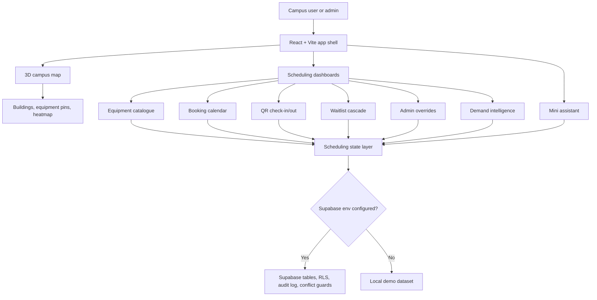

# Zero

> Clash-free smart campus equipment booking with a 3D campus twin, scheduling intelligence, QR check-in, waitlists, and Supabase-ready persistence.

<p align="center">
  
</p>

<p align="center">
  
  
  
  
  
  
</p>

## Table of Contents

- [Overview](#overview)
- [Key Features](#key-features)
- [Tech Stack](#tech-stack)
- [Screenshots and Demo](#screenshots-and-demo)
- [Installation](#installation)
- [Environment Variables](#environment-variables)
- [Project Structure](#project-structure)
- [Architecture](#architecture)
- [Scripts](#scripts)
- [Future Improvements](#future-improvements)
- [Contributing](#contributing)

## Overview

Zero is a smart campus equipment scheduling app built around the ZeroClash product experience. It helps students, faculty, researchers, and admins discover shared equipment, inspect building-level availability, reserve time slots, avoid booking conflicts, manage waitlists, validate check-ins with QR codes, and analyze future demand.

The app runs immediately with demo scheduling data and can optionally connect to Supabase for persistent equipment, booking, waitlist, and audit-log records.

## Key Features

- Interactive 3D campus map built with Three.js and React Three Fiber.
- Building selection, equipment pins, status legends, viewport controls, and usage heatmap overlays.
- Equipment catalogue with category/status filtering and booking entry points.
- Day, week, and month booking calendar with conflict-aware reservation logic.
- QR check-in/check-out flow with generated booking payloads and validation rules.
- Waitlist cascade with priority scoring, offer windows, accept/decline/expire flows, and queue pressure tracking.
- Admin override console for approvals, rejections, conflict resolution, maintenance blocks, and audit entries.
- Demand intelligence dashboard with forecast summaries, utilization views, category rankings, and recommendations.
- Floating mini assistant for common availability, booking, conflict, and QR workflow questions.
- Light/dark theme support with persisted theme preference.
- Supabase integration with mock-data fallback when credentials are not configured.

## Tech Stack

| Layer | Technologies |
| --- | --- |
| Frontend | React 19, TypeScript, Vite |
| 3D experience | Three.js, React Three Fiber, Drei, React Three Postprocessing |
| Styling | Tailwind CSS, custom CSS theme tokens |
| State | React hooks, Zustand campus selection store |
| Data | Local mock dataset, optional Supabase client |
| Database assets | SQL migrations for Supabase/PostgreSQL tables, RLS policies, and booking conflict guards |
| UI assets | Lucide React icons and local equipment icon images |

## Screenshots and Demo

The repository includes a campus preview image:


Local equipment icons are stored in `public/assets/icons/` and are used throughout the catalogue, calendar, map pins, and QR booking views.

## Installation

### Prerequisites

- Node.js 18 or newer
- npm

### Clone the repository

```bash
git clone https://github.com/Saamia18/zero.git
cd zero
```

### Install dependencies

```bash
npm install
```

### Start the development server

```bash
npm run dev
```

Vite will print the local URL in the terminal, usually:

```text
http://localhost:5173
```

### Build for production

```bash
npm run build
```

### Preview the production build

```bash
npm run preview
```

## Environment Variables

Zero can run without environment variables by using the built-in demo dataset.

To enable Supabase persistence, create a local `.env` file based on `.env.example`:

```env
VITE_SUPABASE_URL=https://your-project-ref.supabase.co
VITE_SUPABASE_ANON_KEY=your-public-anon-key
```

Then apply the SQL files in `supabase/migrations/` to your Supabase project.

Do not commit `.env` or private credentials. The repository's `.gitignore` excludes local environment files, dependency folders, build outputs, TypeScript build info, logs, and local inspection artifacts.

## Project Structure

```text
.
├── public/
│   └── assets/              # Equipment sprite sheet and icon images
├── reference/               # Preview/reference image used in this README
├── scripts/                 # Utility scripts for asset preparation
├── src/
│   ├── components/          # Dashboards, calendar, catalogue, QR, sidebar, assistant, UI controls
│   ├── data/                # Mock campus buildings and equipment
│   ├── lib/                 # Scheduling state and Supabase data access
│   ├── scene/               # 3D campus scene, buildings, ground, camera, and equipment pins
│   ├── store/               # Zustand store for campus selection state
│   ├── types/               # Shared scheduling types
│   └── utils/               # Forecasting, QR, and usage heatmap helpers
├── supabase/
│   └── migrations/          # Supabase/PostgreSQL schema and conflict guards
├── package.json
├── tailwind.config.js
└── vite.config.ts
```

## Architecture



## Scripts

| Command | Description |
| --- | --- |
| `npm run dev` | Start the Vite development server |
| `npm run build` | Type-check and create a production build |
| `npm run preview` | Preview the production build locally |

## Future Improvements

- Add authentication and role-based access control for student, faculty, and admin workflows.
- Connect QR scanning to real device camera permissions and deployment-specific check-in rules.
- Add automated tests around booking conflicts, waitlist cascades, and Supabase persistence.
- Add exportable reports for utilization, shortages, and audit history.
- Deploy a hosted demo and add live screenshots or video once available.

## Contributing

Contributions are welcome through pull requests. Keep changes focused, avoid committing secrets or generated dependency/build folders, and run `npm run build` before opening a PR.
